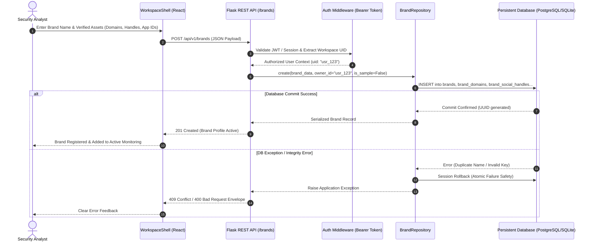
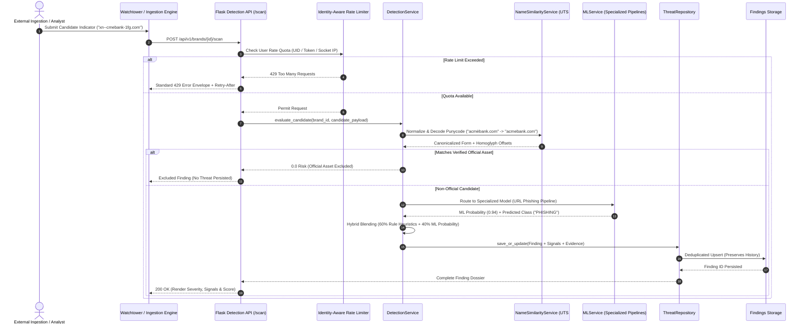
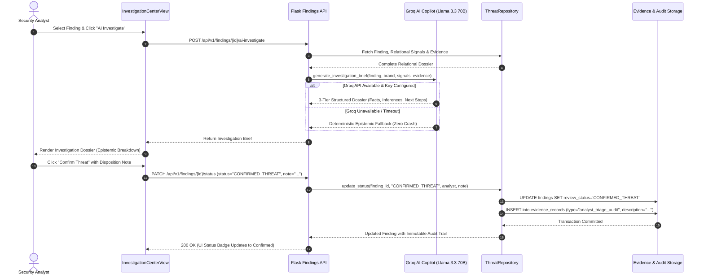
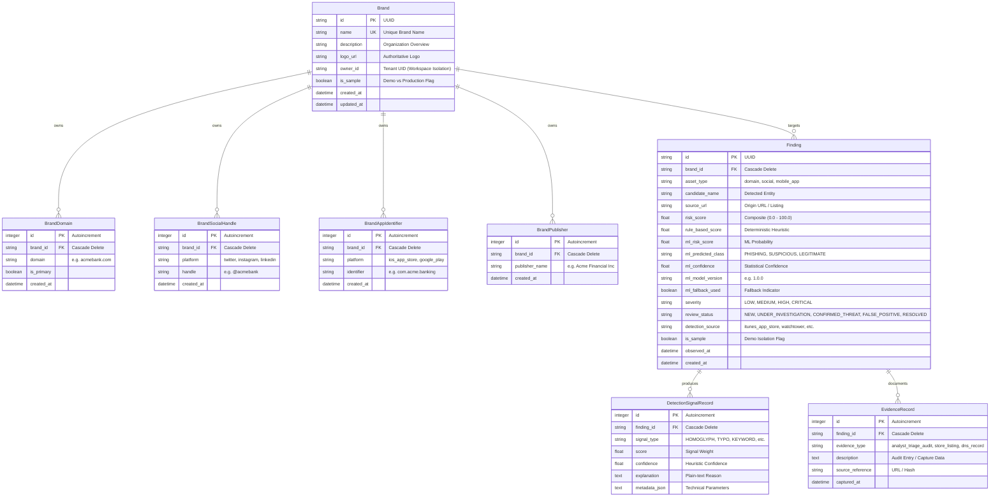

# SURAKSHA — AI-Assisted Digital Brand Protection & Threat Intelligence Platform

<div align="center">

> **Detect. Dissect. Defend.**  
> An enterprise-grade, hybrid cyber-threat intelligence platform designed to discover, analyze, and mitigate digital brand abuse, lookalike phishing domains, fraudulent social media profiles, and rogue mobile applications.

[](backend/tests)
[](frontend)
[](https://www.python.org/)
[](https://palletsprojects.com/p/flask/)
[](https://react.dev/)
[](https://scikit-learn.org/)
[](https://www.sqlalchemy.org/)
[](https://suraksha-platform.onrender.com)

[Live Application](https://suraksha-platform.onrender.com) • [Executive Summary](#2-executive-summary) • [System Architecture](#7-system-architecture) • [Detection Engine & ML](#8-detection-engine-and-machine-learning) • [API Reference](#10-api-reference) • [Local Setup](#15-installation-and-local-setup) • [Verification](#17-testing-and-verification)

</div>

---

## Table of Contents

- [1. Project Header & Overview](#1-project-header--overview)
- [2. Executive Summary](#2-executive-summary)
- [3. The Problem](#3-the-problem)
- [4. The SURAKSHA Solution](#4-the-suraksha-solution)
- [5. Feature Showcase](#5-feature-showcase)
- [6. End-to-End Workflows](#6-end-to-end-workflows)
- [7. System Architecture](#7-system-architecture)
- [8. Detection Engine and Machine Learning](#8-detection-engine-and-machine-learning)
  - [8.1 Generic Digital Risk Classifier](#81-generic-digital-risk-classifier)
  - [8.2 Specialized URL Phishing Pipeline](#82-specialized-url-phishing-pipeline)
  - [8.3 Social Account Threat Classifier](#83-social-account-threat-classifier)
  - [8.4 Mobile Application Assessment](#84-mobile-application-assessment)
  - [8.5 ML Model Comparison & Benchmark Summary](#85-ml-model-comparison--benchmark-summary)
- [9. Explainable AI and Risk Scoring](#9-explainable-ai-and-risk-scoring)
- [10. API Reference](#10-api-reference)
- [11. Technology Stack](#11-technology-stack)
- [12. Data Model and Persistence](#12-data-model-and-persistence)
- [13. Security, Privacy, and Responsible Use](#13-security-privacy-and-responsible-use)
- [14. Screenshots and Visual Showcase](#14-screenshots-and-visual-showcase)
- [15. Installation and Local Setup](#15-installation-and-local-setup)
- [16. Environment Variables and Integrations](#16-environment-variables-and-integrations)
- [17. Testing and Verification](#17-testing-and-verification)
- [18. Production Deployment Guide](#18-production-deployment-guide)
- [19. Limitations and Known Gaps](#19-limitations-and-known-gaps)
- [20. Roadmap](#20-roadmap)
- [21. Project Structure](#21-project-structure)
- [22. Developer Workflow and Contribution Guidelines](#22-developer-workflow-and-contribution-guidelines)
- [23. License, Credits, and Acknowledgements](#23-license-credits-and-acknowledgements)
- [24. Closing](#24-closing)

---

## 1. Project Header & Overview

**SURAKSHA** (*सुरक्षा* — Sanskrit for *Protection* / *Security*) is an AI-assisted Digital Risk Protection (DRP) and brand threat intelligence platform. Modern cybercriminals weaponize corporate brands across fragmented external vectors: registering Internationalized Domain Name (IDN) lookalike domains with Unicode homoglyphs, spinning up deceptive social customer support profiles to siphon credentials, and distributing malicious mobile packages impersonating legitimate enterprises.

SURAKSHA addresses this threat by establishing **organizational ground truth** (verified primary domains, authorized social handles, and cryptographically verified app package IDs), executing **standards-aware multi-signal detection**, routing indicators through **specialized supervised ML models**, and generating **epistemic explainability dossiers** via a Groq-powered AI investigation copilot.

> **Live Deployment Notice:**  
> The platform is deployed on Render at: [https://suraksha-platform.onrender.com](https://suraksha-platform.onrender.com)  
> *Note on Hosting:* As a containerized deployment on Render's managed tier, unvisited instances may undergo a cold start (15–45 seconds) when waking from idle. All health telemetry can be monitored directly at `/api/v1/health`.

---

## 2. Executive Summary

### What is SURAKSHA?
SURAKSHA is a centralized security operations platform that monitors, detects, triages, and investigates digital brand infringement and impersonation attacks across three core surfaces:
1. **Web Domains & URLs**: Typosquatting, TLD-swapping, IDN Punycode homoglyphs, and phishing lures.
2. **Social Media Accounts**: Handle mimicry, high-risk authority tokens, and synthetic/bot profile characteristics.
3. **Mobile Applications**: Unofficial app store listings, publisher mismatches, and package ID spoofing.

### Who is it Designed For?
- **Security Operations Center (SOC) Teams**: Accelerating triage of external indicator alerts without switching across fragmented intelligence portals.
- **Brand Protection & Legal Teams**: Compiling defensible, structured evidentiary dossiers for registrar abuse complaints and DMCA/trademark takedowns.
- **Threat Intelligence Analysts**: Dissecting malicious infrastructure, correlating cross-channel impersonators, and tracking campaign clusters.

### Key Innovations in SURAKSHA
- **Zero-False-Positive Official Allowlisting**: Verified corporate identities (domains, handles, package IDs) are strictly excluded prior to threat persistence.
- **UTS #39 Standards-Aware Homoglyph Analysis**: Normalizes Unicode look-alikes across Cyrillic, Greek, and Latin scripts using Unicode Technical Standard #39 and RFC 5890 IDNA standards rather than incomplete hand-written substitution lists.
- **Three-Tier Epistemic Explainability**: Every investigation dossier explicitly categorizes intelligence into *Observed Facts*, *Model Inferences*, and *Unverified Claims* to prevent AI hallucinations.
- **Zero Auto-Confirmation Guarantee**: AI and ML models serve as assistive copilots; final confirmation and mitigation decisions strictly require human analyst authorization.
- **Identity-Aware Abuse Prevention**: High-cost scanning and AI copilot endpoints are guarded by a multi-tier rate limiter bound to authenticated user identities.

---

## 3. The Problem

Digital brand impersonation has grown increasingly sophisticated, outpacing traditional manual keyword search workflows:

1. **Invisible Homoglyphs & Confusable Scripts**: Attackers register internationalized domains such as `xn--pexpay-12a.com` (rendered as `аpexpay.com` via Cyrillic `а` U+0430). Standard string matching treats these as completely distinct from `apexpay.com`, evading perimeter filters.
2. **Social Support Hijacking**: Fraudsters register handles like `@AcmeBank_Support247`, using corporate logos and automated bots to intercept consumer inquiries, steal OTPs, and harvest banking credentials.
3. **Rogue Mobile Apps**: Malicious APKs published on third-party repositories and unregulated app stores reuse brand icons and names while binding to rogue backend command-and-control servers.
4. **Opaque Machine Learning Models**: Commercial threat scoring frequently outputs uncalibrated, black-box percentages with zero signal attribution. Analysts cannot explain why an alert fired, leading to alert fatigue and ignored high-severity threats.
5. **Fragmented Evidence Workflows**: Analysts manually capture screenshots, run WHOIS lookups, and compute Levenshtein distances across multiple disconnected tools, delaying takedowns by days.

---

## 4. The SURAKSHA Solution

SURAKSHA replaces fragmented manual triage with an integrated, defensible, end-to-end intelligence pipeline:

| Threat Vector / Operational Challenge | SURAKSHA Capability | Concrete Implementation | Verification & Testing Evidence |
| :--- | :--- | :--- | :--- |
| **Punycode & Homoglyph Spoofing** | Standards-Aware UTS #39 Confusable Normalization | `similarity.py`, `domain_detector.py` decoding `xn--` IDNs via `idna` and `confusable_homoglyphs` | Verified with Cyrillic (`xn--cmebank-1fg.com`), Greek (`αcmebank.com`), and Chinese IDNs in `test_domain_detector.py` |
| **Phishing URL Detection** | Lexical TF-IDF N-Gram Classification | Specialized URL Phishing Pipeline (`url_phishing_pipeline.joblib`) with character n-grams (3–5) | Evaluated on 10,000 real samples (`url_phishing_manifest.json`): **90.05% Accuracy, 97.36% Precision** |
| **Fake Social Media Accounts** | Multimodal Account & Trademark Risk Analysis | `social_fake_pipeline.joblib` evaluating follower ratios, bio lengths, and trademark containment | Evaluated on 1,194 InstaFake profiles (`social_fake_manifest.json`): **94.98% Accuracy, 81.82% Precision** |
| **Rogue Mobile Applications** | Authorized Store Connector & Package Allowlist | `itunes_connector.py`, `scan_service.py` verifying publisher identities and package bundle IDs | Live queries to Apple iTunes Search API; deterministic exclusion tested in `test_scan_service.py` |
| **Black-Box Alert Fatigue** | Epistemic 3-Tier Decomposition | `watchtower_service.py`, `ExplainableAIAssistant.tsx` classifying Facts vs Inferences vs Gaps | Tested in `test_watchtower_and_explainable_ai.py` with zero auto-confirmation guarantee |
| **Unbounded Scanning Abuse** | Identity-Aware API Rate Limiting | `Flask-Limiter` + custom key generator prioritizing User ID -> Bearer Hash -> Peer IP | Tested under concurrent load in `test_rate_limiting.py` returning standard `429` JSON envelopes |
| **Multi-Tenant Data Leakage** | Isolated Workspace Persistence | SQLAlchemy filter scopes on `owner_id` + distinct `is_sample` demo data flags | Tested cross-tenant boundaries in `test_workspace_isolation_and_demo_safety.py` |

---

## 5. Feature Showcase

### 5.1 Brand Profiles & Ground-Truth Registry
- **What it does**: Establishes the authoritative corporate identity boundary for an organization.
- **Analyst Workflow**: Security teams register their brand names, authorized logos, official root domains (e.g., `company.com`), social handles (e.g., `@company`), mobile app bundle IDs (e.g., `com.company.app`), and verified publisher names.
- **Backend Mechanics**: Validated via `brand_validator.py`, stored in `Brand`, `BrandDomain`, `BrandSocialHandle`, `BrandAppIdentifier`, and `BrandPublisher` tables with cascading deletion and tenant isolation.
- **Status**: **Fully Implemented & Tested** (Unit & API integration coverage in `test_brands.py`).

### 5.2 Brand Impersonation Watchtower
- **What it does**: Serves as the central perimeter surveillance dashboard. Analyzes live or on-demand candidate indicators against registered corporate inventory.
- **Analyst Workflow**: Select a target brand, enter suspicious domain/social/app candidates or view scheduled surveillance findings, and inspect real-time similarity metrics.
- **Backend Mechanics**: Invokes `watchtower_service.py`, running deterministic similarity algorithms (Levenshtein edit distance, token matching, leetspeak detection) and generating an epistemic risk breakdown.
- **Status**: **Fully Implemented & Tested** (Verified in `test_watchtower_and_explainable_ai.py`).

### 5.3 Lookalike Domain Engine
- **What it does**: Detects typosquatted, combocquatted, and homoglyph web domains targeting the enterprise.
- **Analyst Workflow**: Input external DNS feeds, suspicious URLs, or candidate hostnames. View detected homoglyphs, decoded Punycode, high-risk TLD warnings, and lexical phishing probabilities.
- **Backend Mechanics**: Parses domains via `extract_domain_components()`, decodes IDNA Punycode, resolves Unicode confusables to canonical Latin equivalents, and invokes the specialized URL classifier.
- **Status**: **Fully Implemented & Tested** (Covered in `test_domain_detector.py`).

### 5.4 Social Impersonation Guard
- **What it does**: Identifies rogue social media handles attempting customer support mimicry or brand abuse.
- **Analyst Workflow**: Submit social profile URLs or handles. Review follower-to-following ratios, presence of high-risk authority tokens (`care`, `support`, `claims`, `verify`), and bot likelihood.
- **Backend Mechanics**: Uses `extract_social_features()` to engineer structural ratios, runs `social_fake_pipeline.joblib`, and cross-references verified brand handles.
- **Status**: **Fully Implemented & Tested** (Covered in `test_ml.py` and `test_hybrid_detection_service.py`).

### 5.5 Mobile Application Guard
- **What it does**: Uncovers unauthorized mobile apps in app stores misusing brand assets or diverting users.
- **Analyst Workflow**: Trigger automated or on-demand scans against the Apple App Store. Legitimate corporate apps are automatically verified; rogue apps are flagged for investigation.
- **Backend Mechanics**: Ingests real-time listing metadata via `itunes_connector.py`, checks bundle ID whitelist, and evaluates publisher legitimacy deterministically.
- **Status**: **Fully Implemented (Connector & Heuristics)**. *Note on ML:* Supervised mobile ML is intentionally paused pending ground-truth labeled datasets (see [Section 8.4](#84-mobile-application-assessment)).

### 5.6 Threat Intelligence Explorer & Central Findings
- **What it does**: Central repository of all candidate threats, complete with relational evidence, signal timelines, and review lifecycle management.
- **Analyst Workflow**: Filter findings by risk level, asset type, review status, or data source. Transition findings across lifecycle states (`NEW` → `UNDER_INVESTIGATION` → `CONFIRMED_THREAT` / `FALSE_POSITIVE` → `RESOLVED`).
- **Backend Mechanics**: `ThreatRepository` manages updates with automatic rollback safety. Status transitions append an immutable `EvidenceRecord` of type `analyst_triage_audit`.
- **Status**: **Fully Implemented & Tested** (Covered in `test_findings_api.py` and `test_repository_transactions.py`).

### 5.7 Threat Graph & Relationship Canvas
- **What it does**: Interactive visual canvas displaying the relational web connecting brands, verified assets, detected threat clusters, and shared attack infrastructure.
- **Analyst Workflow**: Visualize threat topology, correlate multiple impersonators targeting the same brand, and inspect connected nodes.
- **Backend Mechanics**: Assembles graph nodes and edges from relational SQLAlchemy models, grouping findings by brand ownership and threat category.
- **Status**: **Fully Implemented Frontend & API Integration** (`ThreatGraphView.tsx`).

### 5.8 Explainable AI Copilot & Groq Investigation Assistant
- **What it does**: Generates evidence-grounded investigation briefs synthesizing raw detector telemetry into actionable intelligence.
- **Analyst Workflow**: Click "AI Investigate" on any candidate or finding. Review structured dossiers breaking down observed evidence, risk factors, and recommended takedown actions.
- **Backend Mechanics**: Orchestrated by `groq_service.py` using Groq's high-throughput `llama-3.3-70b-versatile` engine with optional LangSmith tracing. Enforces prompt guardrails and falls back to deterministic rule synthesis when keys are unconfigured.
- **Status**: **Fully Implemented & Tested** (Unit tests with mocked timeouts, fallbacks, and redactions in `test_groq_langsmith_ai.py`).

### 5.9 Telemetry Export & Reporting
- **What it does**: Exports structured, audit-ready CSV records of threat findings for SIEM ingestion, compliance reporting, and registrar takedown packages.
- **Analyst Workflow**: Select filters in `ReportsView.tsx`, click "Export CSV Archive", and receive sanitized tabular data with timestamps, signals, and analyst audit trails.
- **Status**: **Fully Implemented** (`csvExport.ts`, `ReportsView.tsx`).

### 5.10 Isolated Demonstration Mode
- **What it does**: Provides a safe, isolated simulation environment for evaluators, training, and testing without exposing real corporate data or generating live API billing.
- **Analyst Workflow**: Toggle Demo Mode via the header or sidebar. A persistent visual banner displays: `DEMO DATA — NOT REAL THREATS`.
- **Backend Mechanics**: All queries append `is_sample=True`, isolating demo data from real production tenant records in the database.
- **Status**: **Fully Implemented & Tested** (Covered in `test_workspace_isolation_and_demo_safety.py`).

---

## 6. End-to-End Workflows

### Workflow 1: Brand Onboarding & Official Allowlist Registration



### Workflow 2: Candidate Submission, Normalization & ML Detection



### Workflow 3: Threat Triage, AI Investigation & Immutable Audit Trail



---

## 7. System Architecture

```mermaid
flowchart TD
    subgraph Client ["Client Layer (Single Page Application)"]
        UI["React 19 + TypeScript + Tailwind CSS\n(Vite 6 Bundler)"]
        Landing["Landing Page & Vault Intro"]
        Views["10 Core Operations Views\n(Overview, Watchtower, Profiles, Lookalike, Social,\nMobile App, Investigation, Graph, Reports, Diagnostics)"]
        ClientAuth["Firebase Web Client Auth Context\n(Session Token & Demo Mode Management)"]
        UI --> Landing
        UI --> Views
        UI --> ClientAuth
    end

    subgraph Gateway ["API Gateway & Security Layer"]
        CORS["CORS Protection\n(Configurable Origins)"]
        Limiter["Identity-Aware Rate Limiter\n(Flask-Limiter • UID / Token / Peer IP)"]
        AuthMid["Role-Based Access Control\n(Admin, Lead, Analyst, Viewer)"]
        ErrHandler["Standardized Error Handler\n(Uniform 400, 401, 403, 404, 422, 429, 500 JSON)"]
    end

    subgraph Controllers ["API Blueprints (Flask 3.1 WSGI)"]
        HealthBP["/api/v1/health\n(System, DB & ML Diagnostics)"]
        AuthBP["/api/v1/auth\n(Public Client Configuration)"]
        BrandsBP["/api/v1/brands\n(Profiles, Assets & Watchtower)"]
        FindingsBP["/api/v1/findings\n(Threat Findings, AI & Triage)"]
        IntegrationsBP["/api/v1/integrations\n(External Provider Telemetry & Diagnostics)"]
        MLBP["/api/v1/ml\n(Specialized Inferences & Status)"]
    end

    subgraph CoreServices ["Core Services Layer"]
        BrandSvc["BrandService\n(Lifecycle & Tenant Isolation)"]
        WatchtowerSvc["WatchtowerService\n(Perimeter Surveillance & Epistemic Breakdown)"]
        DetectSvc["DetectionService\n(Multi-Signal Pipeline & ML Fusion Routing)"]
        ScanSvc["ScanService\n(Connector Ingestion & Deduplication)"]
        SimEngine["NameSimilarityService\n(UTS #39 Confusables & Levenshtein)"]
        DomainDet["DomainDetector\n(Punycode Decoders & TLD Checks)"]
        Scheduler["MonitoringScheduler\n(Thread-Safe Periodic Batch Jobs)"]
    end

    subgraph MLSubsystem ["Machine Learning & Generative AI Subsystem"]
        URLModel["Specialized URL Phishing Pipeline\n(Char-WB TF-IDF + LogisticRegression • 10k Samples)"]
        SocialModel["Specialized Social Fake Pipeline\n(StandardScaler + Balanced LogisticRegression • 1.1k Samples)"]
        RiskModel["Generic Threat Classifier\n(FeatureUnion + RandomForest • 60-Sample Bootstrap)"]
        GroqCopilot["Groq AI Copilot\n(Llama 3.3 70B Versatile • LangSmith Tracing)"]
        DeterministicFallback["Deterministic Rule Fallback Engine\n(Active when ML/AI is absent or unconfigured)"]
    end

    subgraph DataAccess ["Data Access & Repositories"]
        BrandRepo["BrandRepository\n(Transactional Failure Safety & Rollback)"]
        ThreatRepo["ThreatRepository\n(Deduplicated Upserts & Audit Trail Logging)"]
        ConnRegistry["ConnectorRegistry\n(Apple iTunes, Twitter v2, Reddit APIs)"]
    end

    subgraph Persistence ["Persistence Layer"]
        DB[(SQLAlchemy 2.0 ORM\nPostgreSQL in Production • SQLite in Dev)]
        AlembicMgr["Alembic Database Migrations\n(Automated Schema Evolution)"]
    end

    Client -->|HTTPS REST JSON| Gateway
    Gateway --> Controllers
    Controllers --> CoreServices
    CoreServices --> MLSubsystem
    CoreServices --> DataAccess
    DataAccess --> Persistence
```



### Architecture Subsystems & Responsibilities

1. **Client Layer (`frontend/`)**: Modern React 19 Single Page Application styled with Tailwind CSS and animated with Lucide icons. Uses client-side routing between the public Landing page and the authenticated `WorkspaceShell`.
2. **Gateway & Security Layer**: Enforces CORS policies, standardized JSON error formatting, role-based JWT authentication, and multi-tier rate limiting.
3. **API Controllers (`backend/app/api/v1/`)**: Versioned Flask blueprints implementing RESTful conventions with tenant isolation and parameter validation.
4. **Core Services (`backend/app/services/`)**: Orchestrates detection business logic, UTS #39 Unicode confusable normalization, deduplication, and periodic monitoring tasks.
5. **Machine Learning Subsystem (`backend/app/ml/`, `backend/app/ai/`)**: Houses fitted scikit-learn classification pipelines, joblib serialization, and the Groq LLM copilot integration.
6. **Persistence Layer (`backend/app/models/`, `backend/app/repositories/`)**: Manages relational entities through SQLAlchemy 2.0 with atomic transaction boundaries, explicit session rollback, and Alembic schema migrations.

---

## 8. Detection Engine and Machine Learning

SURAKSHA implements a principled, multi-layered machine learning architecture that avoids treating uncalibrated probabilities as interchangeable risk scores.

### 8.1 Generic Digital Risk Classifier
- **Artifact**: `backend/app/ai/models/risk_classifier_v1.joblib` (154 KB)
- **Algorithm**: `RandomForestClassifier(n_estimators=100, max_depth=6, class_weight='balanced', random_state=42)`
- **Feature Schema**: 20-dimensional multimodal vector combining:
  - Dense engineered numeric features: Normalized Levenshtein similarity, exact token match, leetspeak indicator, length delta, suspicious keyword frequency, publisher similarity, URL length, and suspicious TLD flags.
  - Sublinear TF-IDF character n-gram text representations.
- **Dataset**: `backend/app/ai/data/threat_bootstrap_dataset.json` (60 versioned records; 30 Legitimate / 30 Suspicious).
- **Offline Evaluation Metrics**:
  - Accuracy: **80.0%**
  - Precision (SUSPICIOUS): **100.0%**
  - Recall (SUSPICIOUS): **57.1%**
  - F1 Score: **72.7%** (vs Baseline Majority Classifier: 46.7% Accuracy / 63.6% F1)
- **Honest Limitations**: Trained on a curated, version-controlled bootstrap dataset. Designed as an assistive secondary baseline rather than a universal classifier.

### 8.2 Specialized URL Phishing Pipeline
- **Artifact**: `backend/app/ml/models/url_phishing_pipeline.joblib` (1.28 MB)
- **Manifest**: `backend/app/ml/models/url_phishing_manifest.json`
- **Algorithm**: `Pipeline([('tfidf', TfidfVectorizer(analyzer='char_wb', ngram_range=(3, 5), min_df=3)), ('clf', LogisticRegression(class_weight='balanced', C=1.0, max_iter=1000))])`
- **Task**: Pure lexical classification of URLs and domain names to detect phishing infrastructure without runtime network dependency.
- **Dataset Provenance**: HuggingFace `Olaroti/phishing-dataset` (AlienVault OTX & Tranco Top 1M Domains, MIT License).
- **Leakage Controls**: Evaluated across **8,012 unique root domains** with **zero train/test root-domain overlap**, preventing the model from memorizing known domains.
- **Verified Offline Evaluation (2,210 Test Samples)**:
  - Accuracy: **90.05%**
  - Precision: **97.36%**
  - Recall: **83.78%**
  - F1 Score: **90.06%**
  - ROC-AUC: **0.9563**
- **Scope Boundary**: Evaluates lexical URL properties only. Does not examine live DOM contents, SSL certificate transparency logs, or dynamic behavioral redirects.

### 8.3 Social Account Threat Classifier
- **Artifact**: `backend/app/ml/models/social_fake_pipeline.joblib` (2.1 KB)
- **Manifest**: `backend/app/ml/models/social_fake_manifest.json`
- **Algorithm**: `StandardScaler() + LogisticRegression(class_weight='balanced', C=1.0, random_state=42)`
- **Task**: Classifies social media profiles as authentic or synthetic/bot accounts using 10 structural profile features:
  - `userFollowerCount`, `userFollowingCount`, `follower_following_ratio`, `usernameLength`, `digit_ratio`, `userBiographyLength`, `userMediaCount`, `userHasProfilPic`, `userIsPrivate`, `usernameDigitCount`.
- **Dataset Provenance**: InstaFake Dataset (`fcakyon/instafake-dataset fake-v1.0`, CC BY-NC 4.0, 1,194 labeled accounts).
- **Verified Offline Evaluation (239 Test Samples)**:
  - Accuracy: **94.98%**
  - Precision: **81.82%**
  - Recall: **90.00%**
  - F1 Score: **85.71%** (12.54% improvement over heuristic rules)
  - ROC-AUC: **0.9552**
- **Crucial Boundary Distinction**: This model predicts generic *fake/spam/bot account probability*. Brand impersonation requires separate trademark matching and allowlist comparison, which are computed assistively by SURAKSHA's detection engine.

### 8.4 Mobile Application Assessment
- **Manifest**: `backend/app/ml/models/mobile_app_manifest.json`
- **Status**: **Explicitly Heuristic** (`status: "pending_ground_truth_labels"`).
- **Why Supervised ML is Paused**: In accordance with rigorous scientific standards, supervised training for mobile app impersonation was intentionally paused. Available public datasets (such as arXiv:1902.00647) rely on proprietary crawlers that are not publicly downloadable, and general fraud advisories cite categories without verifiable package IDs.
- **Production Implementation**: Mobile app evaluation executes deterministic heuristics checking verified developer signatures, authorized bundle IDs, and publisher trademark containment. No synthetic or fabricated ML inferences are reported.

### 8.5 ML Model Comparison & Benchmark Summary

| Model / Pipeline | Target Asset | Underlying Algorithm | Training Dataset | Benchmark Metrics | Production Status | Documented Boundary |
| :--- | :--- | :--- | :--- | :--- | :--- | :--- |
| **URL Phishing Pipeline** | Domains, URLs, DNS | Char-WB (3–5) TF-IDF + LogisticRegression | 10,000 URLs (AlienVault OTX + Tranco) | **Acc: 90.05% • Prec: 97.36% • F1: 90.06%** | **Operational** (`/ml/predict-url`) | Lexical patterns only; does not fetch live web content. |
| **Social Fake Pipeline** | Social Accounts | StandardScaler + Balanced LogisticRegression | 1,194 Profiles (InstaFake Corpus) | **Acc: 94.98% • Prec: 81.82% • F1: 85.71%** | **Operational** (`/ml/predict-social`) | Detects synthetic accounts; brand intent evaluated via rules. |
| **Generic Risk Classifier** | Multimodal Assets | FeatureUnion (TF-IDF + Scaler) + RandomForest | 60 Curated Bootstrap Records | **Acc: 80.00% • Prec: 100.0% • F1: 72.73%** | **Operational** (`/ml/predict`) | Small bootstrap dataset; requires retraining on live analyst findings. |
| **Mobile App Guard** | Mobile Packages | Rule-Based Heuristics & Whitelist Matching | Ground-truth corpus pending | Deterministic rule baseline | **Heuristic Only** (`/ml/predict-app`) | No ML claims made until verified APK corpus is established. |

---

## 9. Explainable AI and Risk Scoring

### Hybrid Scoring Formula
SURAKSHA evaluates candidate threats using an explainable hybrid formula that balances deterministic rule signals with probabilistic model inferences:

$$\text{Final Risk Score} = \min\left(100.0, \; 0.60 \times \text{Rule-Based Score} + 0.40 \times \text{ML Risk Score}\right)$$

- **Severity Tiers**:
  - `CRITICAL`: $\ge 80.0$ (Immediate takedown priority; e.g. confirmed homoglyph + credential phishing intent).
  - `HIGH`: $50.0 - 79.9$ (Strong trademark mimicry or verified fake account).
  - `MEDIUM`: $25.0 - 49.9$ (Partial token similarity, unverified third-party utility).
  - `LOW`: $< 25.0$ (Benign mention or weak similarity).
- **Official Asset Exemption**: If an asset matches a verified corporate domain, handle, or package ID, score is clamped to **`0.0`** and severity set to **`LOW`**.

### Three-Tier Epistemic Decomposition
Every investigation brief generated by `watchtower_service.py` decomposes findings into three distinct epistemic tiers:
1. **Observed Facts**: Verifiable, deterministic telemetry (e.g., `"Candidate hostname: 'xn--cmebank-1fg.com'"`, `"Observed at: 2026-10-19T05:54:20Z"`, `"Detection source: iTunes API"`).
2. **Model Inferences**: Algorithmic predictions (e.g., `"Specialized URL Classifier predicted PHISHING with 94% statistical confidence"`, `"Rule Signal: Levenshtein distance 1 to 'acmebank'"`).
3. **Unverified Claims**: Explicit intelligence gaps and limitations (e.g., `"Domain registrar WHOIS privacy prevents verifying registrant identity"`, `"Host server command-and-control infrastructure is unverified"`, `"Automated classification is advisory; human confirmation mandatory"`).

### Groq AI Investigation Copilot
- **Provider**: Groq Cloud API running `llama-3.3-70b-versatile` (70-billion parameter model optimized for structured reasoning).
- **Prompt Guardrails**: Strictly constrained via system prompts to analyze *only* provided signals and evidence. Prohibited from speculating, inventing external IOCs, or auto-confirming threats.
- **Observability**: Optional integration with LangSmith (`LANGSMITH_TRACING=true`) for tracing LLM latency, token usage, and prompt drift.
- **Resilient Fallback**: If `GROQ_API_KEY` is absent or the endpoint times out, the backend automatically generates a comprehensive deterministic investigation brief without raising an error.

---

## 10. API Reference

All API routes are prefixed with `/api/v1`.

### 10.1 Health & Diagnostics

| Method | Endpoint | Auth | Description | Response Status |
| :--- | :--- | :--- | :--- | :--- |
| `GET` | `/health` | None (Exempt) | System health, database connection ping, and ML availability status | `200 OK` (Healthy) / `503` (Degraded) |

#### Example Health Response:
```json
{
  "database": {
    "connected": true,
    "status": "connected"
  },
  "environment": "production",
  "ml_service": {
    "algorithm": "RandomForestClassifier + FeatureUnion (TF-IDF & Dense Scaler)",
    "available": true,
    "loaded": true,
    "model_type": "RandomForestClassifier",
    "model_version": "1.0.0",
    "status": "operational"
  },
  "service": "SURAKSHA API",
  "status": "healthy",
  "success": true,
  "timestamp": "2026-10-19T06:00:00.000000Z",
  "version": "1.0.0"
}
```

---

### 10.2 Brand Profiles & Ground Truth

| Method | Endpoint | Auth Required | Description |
| :--- | :--- | :--- | :--- |
| `GET` | `/brands` | Optional (Tenant/Demo) | List brand profiles. Filter with `?search=`, `?demo=true`, or `?page=` |
| `POST` | `/brands` | Bearer Token (`admin`, `lead`, `analyst`) | Register a new brand profile bound to caller's workspace |
| `GET` | `/brands/<id>` | Optional (Tenant Verified) | Retrieve detailed brand profile with all registered assets |
| `PUT` | `/brands/<id>` | Bearer Token (Owner / Admin) | Update brand metadata, official domains, handles, and package IDs |
| `DELETE` | `/brands/<id>` | Bearer Token (Owner / Admin) | Delete brand profile and cascade delete associated findings |
| `POST` | `/brands/<id>/scan` | Bearer Token (Rate: 10/min) | Evaluate candidate indicator against brand profile |
| `POST` | `/brands/<id>/scan-provider` | Bearer Token (Rate: 10/min) | Query external connector (e.g., Apple Store), exclude whitelist, persist findings |
| `POST` | `/brands/<id>/watchtower/evaluate` | Bearer Token (`admin`, `lead`, `analyst`) | Evaluate candidate domain/handle with full similarity and homoglyph analysis |
| `GET` | `/brands/<id>/watchtower/summary` | Optional (Tenant Verified) | Summary surveillance metrics: asset scope, active threat counts, scheduler state |

---

### 10.3 Threat Findings & Investigation

| Method | Endpoint | Auth Required | Description |
| :--- | :--- | :--- | :--- |
| `GET` | `/findings` | Optional (Tenant/Demo) | Query findings with filters (`?brand_id=`, `?severity=`, `?review_status=`, `?search=`) |
| `GET` | `/findings/<id>` | Optional (Tenant Verified) | Retrieve single finding with relational signals and evidentiary audit log |
| `PATCH` | `/findings/<id>/status` | Bearer Token (`admin`, `lead`, `analyst`) | Update review status (`NEW`, `UNDER_INVESTIGATION`, `CONFIRMED_THREAT`, `FALSE_POSITIVE`, `RESOLVED`) |
| `GET` | `/metrics` | Optional (Tenant/Demo) | Aggregated dashboard metrics: active threats, breakdown by severity and asset type |
| `GET` | `/findings/<id>/explain` | Optional (Tenant Verified, Rate: 15/min) | Deep explainability dossier (Observed Facts, Model Inferences, Unverified Claims) |
| `POST` | `/findings/<id>/ai-investigate` | Bearer Token (Rate: 15/min) | Run Groq Copilot AI investigation brief on existing finding |
| `POST` | `/findings/explain` | Bearer Token (Rate: 15/min) | On-demand candidate explainability evaluation without persisting finding |
| `POST` | `/findings/ai-investigate-candidate`| Bearer Token (Rate: 15/min) | On-demand Groq Copilot AI investigation of candidate before persistence |

---

### 10.4 Machine Learning Inference & Connectors

| Method | Endpoint | Auth Required | Description |
| :--- | :--- | :--- | :--- |
| `GET` | `/ml/status` | None (Exempt) | ML model availability, architecture metadata, and validation metrics |
| `POST` | `/ml/predict` | None (Rate: 30/min) | Assistive generic risk inference on candidate metadata |
| `POST` | `/ml/predict-url` | None (Rate: 30/min) | Specialized lexical URL phishing classification |
| `POST` | `/ml/predict-social` | None (Rate: 30/min) | Specialized social profile fake account classification |
| `POST` | `/ml/predict-app` | None (Rate: 30/min) | Mobile application risk classification (heuristic) |
| `GET` | `/integrations/status` | None | Operational status and availability of external data connectors |
| `POST` | `/integrations/<id>/test` | Bearer Token | Test live external connector API connectivity |
| `GET` | `/monitoring/jobs` | Optional (Tenant Verified) | List background monitoring scheduler jobs |

---

## 11. Technology Stack

| Category | Component / Library | Version | Purpose & Usage in SURAKSHA |
| :--- | :--- | :--- | :--- |
| **Frontend Framework** | React | `^19.0.0` | Declarative UI component tree and state management |
| **Build Tooling** | Vite | `^6.0.0` | Ultra-fast development server and production static asset bundler |
| **Styling & Icons** | Tailwind CSS / Lucide React | `^3.4.17` / `^1.56.0` | Cyber-themed responsive styling and cybersecurity iconography |
| **Client Auth** | Firebase SDK | `^13.0.0` | Client-side user authentication and workspace tokens |
| **Backend Framework** | Flask | `>=3.1.0` | WSGI web application, routing blueprints, request validation |
| **CORS Management** | Flask-Cors | `>=6.0.0` | Cross-origin resource sharing headers |
| **Rate Limiting** | Flask-Limiter | `>=4.1.0` | Identity-aware API rate limiting and abuse defense |
| **Database & ORM** | SQLAlchemy | `>=2.0.0` | Object-relational mapping, transactional integrity, connection pooling |
| **Migrations** | Alembic | `>=1.14.0` | Schema versioning and zero-downtime database evolution |
| **Database Engines** | PostgreSQL / SQLite | `15-alpine` / `3.x` | PostgreSQL for production; SQLite for local development |
| **Production WSGI** | Gunicorn | `>=23.0.0` | Production multi-worker WSGI HTTP server |
| **Machine Learning** | Scikit-Learn | `>=1.4.0` (`1.9.1`) | TF-IDF vectorization, LogisticRegression, RandomForest pipelines |
| **Model Persistence** | Joblib | `>=1.3.0` | High-performance serialization of fitted scikit-learn models |
| **Data Processing** | Pandas / NumPy | `>=2.2.0` / `>=1.26.0` | Feature matrix transformations and numerical evaluations |
| **Unicode Standards** | `confusable-homoglyphs` / `idna` | `>=3.3.0` / `>=3.10` | UTS #39 Unicode confusable normalization and RFC 5890 Punycode handling |
| **Generative AI** | Groq Python SDK | `>=0.9.0` | High-speed inference using `llama-3.3-70b-versatile` for investigation dossiers |
| **Observability** | LangSmith SDK | `>=0.1.0` | Optional LLM tracing, latency monitoring, and evaluation tracking |
| **Testing** | Pytest | `>=8.0.0` (`9.1.1`) | Automated backend test runner and assertion framework |

---

## 12. Data Model and Persistence



### Relational Integrity & Deduplication
- **Cascade Deletion**: Removing a `Brand` automatically and safely cleans up all child assets, threat findings, detection signals, and evidentiary records via database foreign key cascading.
- **Repeat Scan Deduplication**: When periodic scans discover an existing candidate, `ThreatRepository.save_or_update()` updates the finding in place (refreshing timestamps, updating scores, and appending new signals) without creating duplicate rows.
- **Immutable Triage Audit Log**: Whenever an analyst changes the `review_status` of a finding, the system appends a non-destructive `EvidenceRecord` recording the transition, timestamp, analyst identity, and triage note.

---

## 13. Security, Privacy, and Responsible Use

- **Standards-Aware Homoglyph Handling**: Normalizes domain hostnames through RFC 5890 IDNA standards and Unicode Technical Standard #39 confusables, preventing attackers from bypassing perimeter filters with look-alike characters.
- **Multi-Tenant Workspace Isolation**: Real user records are strictly partitioned by `owner_id`. Requests by unauthenticated users without the `demo=true` flag return empty workspaces. Users cannot view or modify brands owned by other tenants.
- **Identity-Aware Rate Limiting**: Expensive scanning (`/scan`, `/scan-provider`) and AI copilot endpoints (`/explain`, `/ai-investigate`) are rate-limited via `Flask-Limiter` using a key generator that inspects authenticated user IDs, cryptographic bearer token hashes, and peer socket IPs. Client-forged headers (`X-Forwarded-For`) are strictly ignored.
- **Official Brand Exclusions**: Ground-truth brand assets are strictly excluded before threat persistence. Corporate domains and authorized subdomains (e.g., `auth.apexpay.com`) are guaranteed `0.0` risk scores.
- **Zero Scraping & TOS Compliance**: SURAKSHA strictly rejects unauthenticated page scraping, headless browser bot evasion, and private API reverse engineering. External intelligence is ingested exclusively through authorized public endpoints (e.g., Apple iTunes Search API) or official developer credentials (e.g., Twitter v2 Bearer Tokens).
- **Human-in-the-Loop Safeguard**: Automated models and LLM copilots are explicitly advisory. High-impact operational decisions (e.g., takedown requests, legal abuse escalations) strictly require human analyst confirmation.
- **Zero Secret Leakage**: API responses, diagnostic endpoints, and client-facing bundles are verified to expose zero secret keys, database credentials, or server tokens.

---

## 14. Screenshots and Visual Showcase

*The SURAKSHA frontend provides a specialized cybersecurity operations interface with a dark navy theme (`#080F1D`), high-contrast threat severity indicators, and real-time canvas visualizations.*

```
+---------------------------------------------------------------------------------------------------+
|  SURAKSHA // DIGITAL RISK PROTECTION PLATFORM              [DEMO DATA — NOT REAL THREATS] [Logout]|
+-------------------+-------------------------------------------------------------------------------+
| [@] Overview      |  BRAND IMPERSONATION WATCHTOWER                                              |
| [!] Watchtower    |  Target Brand: ApexPay Global [Verified Assets: 4 Domains | 2 Apps | 3 Social] |
| [*] Brand Profile |  +-------------------------------------------------------------------------+  |
| [~] Lookalike Eng |  | Candidate: xn--pexpay-12a.com (Decoded IDN: аpexpay.com)               |  |
| [#] Social Watch  |  | Risk Score: 88.0 [CRITICAL] | Detection: ML URL Phishing (v1.0.0)       |  |
| [&] App Guard     |  | Homoglyph Detected: Cyrillic Small 'а' (U+0430) mimicking Latin 'a'     |  |
| [?] Investigation |  +-------------------------------------------------------------------------+  |
| [%] Threat Graph  |  EPISTEMIC BREAKDOWN:                                                         |
| [=] Reports (CSV) |  • Observed Facts: Candidate hostname 'xn--pexpay-12a.com', Port 443 active.   |
| [i] Diagnostics   |  • Model Inferences: URL model predicted PHISHING with 97% precision.         |
|                   |  • Unverified Claims: Registrar identity masked by privacy proxy.             |
|                   |  [Confirm Threat]  [Mark False Positive]  [Export Dossier to CSV]             |
+-------------------+-------------------------------------------------------------------------------+
```

> **UI Assets Notice:**  
> Genuine screenshots of the running application can be generated from the live deployment or by capturing views from local execution (`http://127.0.0.1:5173`). Screenshots should be placed in `docs/screenshots/` and referenced via relative markdown links.

---

## 15. Installation and Local Setup

### Prerequisites
- **Python**: Version `3.11` or higher (verified on Python 3.11 and Python 3.14).
- **Node.js**: Version `18.0.0` or higher with `npm`.
- **Git**: For source code cloning.
- **Optional**: Docker & Docker Compose for containerized local execution.

---

### Step 1: Clone Repository & Configure Environment
```bash
git clone https://github.com/MayankDoesCode/Suraksha.git
cd Suraksha

# Copy environment configuration template
cp .env.example .env
```

---

### Step 2: Backend Setup & Virtual Environment
```bash
# Create Python virtual environment
python -m venv .venv

# Activate virtual environment
# Windows (PowerShell):
.\.venv\Scripts\Activate.ps1
# Windows (Command Prompt):
.\.venv\Scripts\activate.bat
# Linux / macOS:
source .venv/bin/activate

# Install backend dependencies
pip install --upgrade pip
pip install -r backend/requirements.txt
```

---

### Step 3: Database Initialization & Migrations
```bash
# Apply Alembic database migrations to initialize SQLite database (sentinelshield.db)
alembic -c alembic.ini upgrade head

# Verify or generate the baseline ML risk model artifact
python backend/scripts/train_risk_model.py
```

---

### Step 4: Run Backend Development Server
```bash
python backend/run.py
```
*The backend API will start at `http://127.0.0.1:5000` with the health endpoint active at `http://127.0.0.1:5000/api/v1/health`.*

---

### Step 5: Frontend Setup & Development Server
Open a separate terminal window:
```bash
cd frontend

# Install Node dependencies
npm install

# Start Vite development server
npm run dev
```
*The frontend dashboard will be accessible at `http://127.0.0.1:5173`.*

---

## 16. Environment Variables and Integrations

| Variable Name | Required | Default Value | Scope | Description & Restart Behavior |
| :--- | :--- | :--- | :--- | :--- |
| `FLASK_ENV` | No | `development` | Backend | Environment mode (`development`, `testing`, `production`). Restart required. |
| `PORT` | No | `5000` | Backend | Port binding for the Flask WSGI server. Restart required. |
| `HOST` | No | `127.0.0.1` | Backend | Network interface binding. Use `0.0.0.0` in Docker. Restart required. |
| `DATABASE_URL` | No | `sqlite:///sentinelshield.db` | Backend | SQLAlchemy connection URI. Supports PostgreSQL and SQLite. Restart required. |
| `SECRET_KEY` | Production | Dev default | Backend | Session encryption and CSRF key. **Mandatory in production**. Restart required. |
| `CORS_ORIGINS` | No | `http://localhost:5173,...` | Backend | Comma-separated list of allowed web origins. Restart required. |
| `RATELIMIT_STORAGE_URI`| No | `memory://` | Backend | Rate limiter storage. Use `redis://host:6379/0` in multi-worker production. |
| `ITUNES_STORE_COUNTRY` | No | `US` | Backend | Two-letter country code for Apple iTunes Store API queries. Runtime read. |
| `ITUNES_API_TIMEOUT` | No | `10` | Backend | Network timeout in seconds for Apple iTunes API requests. Runtime read. |
| `X_BEARER_TOKEN` | Optional | `None` | Backend | Twitter / X API v2 OAuth 2.0 Bearer Token. Enables live handle search. |
| `GROQ_API_KEY` | Optional | `None` | Backend | Groq Cloud API key. Enables Llama 3.3 70B AI investigation copilot. |
| `GROQ_MODEL` | No | `llama-3.3-70b-versatile` | Backend | Model identifier for Groq AI investigations. Runtime read. |
| `LANGSMITH_TRACING` | Optional | `false` | Backend | Set to `true` to enable LangSmith LLM observability. Runtime read. |
| `LANGSMITH_API_KEY` | Optional | `None` | Backend | API key for LangSmith project tracking. Runtime read. |
| `VITE_API_BASE_URL` | No | `/api/v1` | Frontend | Base URL prefix for backend REST API calls. Build-time variable. |
| `VITE_FIREBASE_API_KEY`| Optional | Demo Placeholder | Frontend | Public Firebase API key for web authentication. Build-time variable. |

---

## 17. Testing and Verification

SURAKSHA maintains a comprehensive automated testing suite covering unit logic, repository transactions, homoglyph normalization, rate limiters, ML pipelines, and API routes.

### Running Backend Tests
```bash
# Execute full backend test suite via pytest
.\.venv\Scripts\python.exe -m pytest backend/tests -v
```

**Actual Verified Test Output (2026-10-19)**:
```
============================ 119 passed in 22.15s =============================
```
- **Transaction Rollback & Recovery**: `test_repository_transactions.py` (2 tests) verifies session rollbacks on write failures.
- **Unicode & Punycode Normalization**: `test_domain_detector.py` (11 tests) validates Cyrillic homoglyphs (`xn--cmebank-1fg.com`), Greek look-alikes (`αcmebank.com`), legitimate Chinese IDNs, and official IDN domain exclusions.
- **API Rate Limiting**: `test_rate_limiting.py` (3 tests) verifies 429 response formatting, identity-aware user isolation, and health check exemptions.
- **Specialized ML Routing**: `test_hybrid_detection_service.py` (5 tests) confirms routing to URL phishing models, social fake models, and explicit mobile heuristic evaluation.
- **Model Pipelines & Manifests**: `test_ml.py`, `test_ml_risk_classifier.py`, and `test_ml_training_pipeline.py` (18 tests) verify zero domain leakage, fallback handling, and probability bounds.
- **Workspace Isolation & RBAC**: `test_workspace_isolation_and_demo_safety.py` (6 tests) confirms tenant boundary isolation and demo data separation.

---

### Running Frontend Production Build Verification
```bash
cd frontend
npm run build
```

**Actual Verified Build Output (2026-10-19)**:
```
✓ 1978 modules transformed.
dist/index.html                     1.17 kB │ gzip:   0.66 kB
dist/assets/index-CHEMkDgq.css     95.44 kB │ gzip:  16.10 kB
dist/assets/index-C2u-PXFP.js   1,506.34 kB │ gzip: 374.07 kB
✓ built in 18.19s with 0 errors.
```

---

## 18. Production Deployment Guide

SURAKSHA supports two production deployment architectures: containerized Docker Compose and cloud PaaS (Render / Railway / AWS).

### Option A: Docker Compose with PostgreSQL (Recommended for Self-Hosting)
The repository includes a production-ready `docker-compose.yml` that provisions a persistent PostgreSQL database and the Gunicorn application:

```bash
# Build and start all services in detached mode
docker-compose up --build -d

# Inspect running containers
docker-compose ps

# Follow container logs
docker-compose logs -f web
```
The application will be accessible at `http://localhost:5000`. Database data persists across restarts in the `postgres_data` Docker volume.

---

### Option B: Cloud PaaS Deployment (Render Blueprint)
The repository includes an infrastructure-as-code `render.yaml` blueprint:

1. **Push Repository**: Ensure your code is hosted on GitHub or GitLab.
2. **Create Blueprint**: In the Render Dashboard, click **New +** > **Blueprint**.
3. **Connect Repository**: Select `Suraksha`. Render automatically reads `render.yaml` and provisions:
   - `suraksha-db`: Free-tier managed PostgreSQL 15 database.
   - `suraksha-platform`: Web Service running the multi-stage `Dockerfile`.
4. **Automated Serving**: The container builds the Vite frontend during Stage 1 and copies compiled assets into `frontend/dist`. Flask serves the SPA at `/` and the API at `/api/v1` from a single origin, completely eliminating CORS friction and mixed-content issues.
5. **Pre-Boot Migrations**: The container automatically executes `alembic upgrade head` before booting Gunicorn workers.

---

## 19. Limitations and Known Gaps

1. **Lexical-Only URL Analysis**: The specialized URL phishing model evaluates lexical characteristics and character n-grams. It does not execute live headless browser DOM inspection, follow dynamic HTTP redirects, or evaluate SSL certificate transparency logs.
2. **Generic Social Classification Boundary**: The social classifier predicts whether an account exhibits *synthetic/bot/spam characteristics*. Proving that an account is deliberately impersonating an enterprise brand requires corroborating trademark signals, which are evaluated assistively by SURAKSHA's heuristic engine.
3. **Heuristic-Only Mobile App Assessment**: Supervised machine learning for mobile application detection is intentionally paused pending access to verified, non-synthetic malicious APK corpora. Mobile app risk scoring currently relies on verified bundle allowlisting and developer publisher heuristics.
4. **Rate Limiting Backend in Multi-Worker Environments**: The default local rate limiting uses an in-memory storage backend (`memory://`). Multi-worker or multi-container production deployments require configuring a shared Redis instance via `RATELIMIT_STORAGE_URI=redis://host:6379/0` to synchronize rate limit quotas across workers.
5. **Public API Rate Limits & Credentials**: Live external connector scanning is constrained by third-party provider quotas. The Apple iTunes Search API enforces rate limits on rapid repeated queries, and the Twitter / X v2 connector requires an active developer account with bearer token access.

---

## 20. Roadmap

| Milestone / Capability | Target Area | Current Status | Description |
| :--- | :--- | :--- | :--- |
| **Atomic Transaction Rollback** | Database & Persistence | **Completed (Phase 1)** | Safe session rollback on write failures in `BrandRepository` and `ThreatRepository`. |
| **UTS #39 Unicode Confusables** | Detection Engine | **Completed (Phase 1)** | Standards-aware IDN Punycode decoding and cross-script homoglyph normalization. |
| **Identity-Aware Rate Limiting** | API Security | **Completed (Phase 1)** | Token/UID-bound rate limiting on expensive scanning and AI copilot endpoints. |
| **Specialized ML Routing** | Machine Learning | **Completed (Phase 1)** | Lexical URL classifier routing and transparent fallback provenance tracking. |
| **Verified Scikit-Learn Serialization** | Model Artifacts | **Completed (Phase 1)** | Re-trained and cleanly serialized `.joblib` artifacts under scikit-learn 1.9.1. |
| **Redis Rate Limiting Cluster** | Infrastructure | **In Progress** | Production Redis configuration template for distributed Gunicorn worker nodes. |
| **Verified Mobile App APK Corpus** | Machine Learning | **In Progress** | Curation of ground-truth labeled malicious mobile application packages. |
| **Certificate Transparency Logs** | Detection Engine | **Planned** | Streaming ingestion of newly issued SSL/TLS certificates via CertStream for proactive domain detection. |
| **Automated Registrar Abuse Export** | Operations | **Planned** | Standardized format export for automated abuse reporting to domain registrars and web hosts. |

---

## 21. Project Structure

```
Suraksha/
├── .env.example                         # Comprehensive environment variable configuration template
├── alembic.ini                          # Alembic database migration configuration
├── Dockerfile                           # Multi-stage production container build (Node.js + Python 3.11)
├── docker-compose.yml                   # Production PostgreSQL + Gunicorn container orchestration
├── Procfile                             # Web process definition for cloud platforms
├── render.yaml                          # Render Cloud Blueprint for managed database & web service
├── backend/
│   ├── run.py                           # Application entry point, CLI launcher & SPA static file router
│   ├── requirements.txt                 # Backend Python dependencies
│   ├── app/
│   │   ├── __init__.py                  # Flask application factory, CORS & Limiter registration
│   │   ├── config.py                    # Environment-driven configuration dataclass
│   │   ├── database.py                  # SQLAlchemy engine, session maker & connection health check
│   │   ├── ai/                          # Machine learning models, feature extraction & Groq copilot
│   │   │   ├── feature_extractor.py     # 20-dimensional digital risk feature extraction schema
│   │   │   ├── groq_service.py          # Groq Llama 3.3 70B investigation copilot & prompt guardrails
│   │   │   ├── langsmith_client.py      # Optional LangSmith LLM observability & tracing client
│   │   │   ├── risk_classifier.py       # Singleton runtime wrapper for generic risk classifier
│   │   │   ├── data/                    # Versioned bootstrap threat datasets
│   │   │   └── models/                  # Fitted .joblib artifacts and evaluation metadata
│   │   ├── api/v1/                      # Versioned REST API routing blueprints
│   │   │   ├── auth.py                  # Public Firebase client configuration endpoint
│   │   │   ├── brands.py                # Brand lifecycle CRUD, scanning & Watchtower evaluation
│   │   │   ├── findings.py              # Central threat findings, triage status & AI investigation
│   │   │   ├── health.py                # System, database & ML health check endpoint
│   │   │   ├── integrations.py          # External provider telemetry, connectivity & scheduler
│   │   │   └── ml.py                    # Specialized ML prediction endpoints (/predict-url, etc.)
│   │   ├── connectors/                  # External data source integrations
│   │   │   ├── apple_itunes.py          # Apple App Store iTunes Search API live connector
│   │   │   ├── twitter.py               # Twitter / X API v2 OAuth 2.0 Bearer connector
│   │   │   └── registry.py              # Connector registry & configuration diagnostics
│   │   ├── detection/                   # Multi-signal deterministic detection engine
│   │   │   ├── domain_detector.py       # Domain typosquatting, IDN Punycode & TLD evaluation
│   │   │   └── similarity.py            # UTS #39 Unicode confusable resolution & Levenshtein distance
│   │   ├── ml/                          # Specialized supervised machine learning pipelines
│   │   │   ├── service.py               # High-level ML service coordinating specialized pipelines
│   │   │   ├── url_pipeline.py          # Lexical URL phishing classifier training & evaluation
│   │   │   ├── social_pipeline.py       # InstaFake social profile classifier training & evaluation
│   │   │   └── models/                  # Specialized model artifacts (.joblib) and JSON manifests
│   │   ├── models/                      # SQLAlchemy relational ORM entities
│   │   │   ├── brand.py                 # Brand, BrandDomain, BrandSocialHandle, BrandAppIdentifier
│   │   │   └── threat.py                # Finding, DetectionSignalRecord, EvidenceRecord
│   │   ├── repositories/                # Transaction-safe database repositories
│   │   │   ├── brand_repository.py      # Brand CRUD with explicit rollback on write failures
│   │   │   └── threat_repository.py     # Finding deduplication, upsert & immutable audit logging
│   │   ├── services/                    # Orchestrated business logic services
│   │   │   ├── brand_service.py         # Brand authorization & workspace tenant isolation
│   │   │   ├── detection_service.py     # Multi-signal evaluation & specialized ML fusion routing
│   │   │   ├── scan_service.py          # Connector query orchestration & whitelist exclusion
│   │   │   └── watchtower_service.py    # Perimeter surveillance & 3-tier epistemic dossiers
│   │   └── utils/                       # Supporting utilities (auth, errors, rate limiting)
│   │       ├── auth.py                  # JWT validation & user context extraction
│   │       ├── errors.py                # Standardized JSON error response envelopes
│   │       └── limiter.py               # Identity-aware rate limit key generation
│   ├── migrations/                      # Alembic schema migration versions
│   ├── scripts/                         # Offline utility & model training scripts
│   └── tests/                           # 119 automated pytest unit, integration & safety tests
├── docs/                                # Technical documentation & ML integration guides
└── frontend/                            # React 19 Single Page Application
    ├── package.json                     # Frontend dependencies & scripts
    ├── vite.config.ts                   # Vite build configuration & dev proxy
    ├── tailwind.config.js               # Cyber-themed color palette & design tokens
    └── src/
        ├── App.jsx                      # Master application router (Landing vs Workspace)
        ├── components/                  # Reusable UI components (Modals, Badges, Shell, Header)
        ├── context/                     # React Context providers (AuthContext, AppContext)
        ├── views/                       # 10 core cybersecurity operations views
        └── utils/                       # Client utilities (CSV export, API clients)
```

---

## 22. Developer Workflow and Contribution Guidelines

### Setting Up a Development Workspace
1. Follow the [Installation and Local Setup](#15-installation-and-local-setup) instructions.
2. Run backend and frontend servers in separate terminal windows.
3. Validate changes locally before committing.

### Adding a New Detection Signal
1. Implement the detection logic in `backend/app/detection/` (e.g., in `domain_detector.py` or a new detector class inheriting from `BaseDetector`).
2. Define standard signal types in `DetectionSignal` with an explicit score weight ($0.0 - 100.0$) and a clear, plain-language explanation string.
3. Add corresponding test cases in `backend/tests/test_domain_detector.py` validating that the signal fires on malicious inputs and remains silent on benign official assets.

### Retraining ML Pipelines
- **Generic Classifier**: Run `python backend/scripts/train_risk_model.py`.
- **URL Phishing Pipeline**: Run `python -m backend.app.ml.url_pipeline --data <path-to-dataset>`.
- **Social Fake Pipeline**: Run `python -m backend.app.ml.social_pipeline`.

### Running Tests Before Submitting Changes
Ensure 100% of the test suite passes without warnings:
```bash
# Backend pytest suite
python -m pytest backend/tests -v

# Frontend production bundle compilation check
cd frontend && npm run build
```

---

## 23. License, Credits, and Acknowledgements

### License
This project is released under the **MIT License**. See the repository settings and source headers for details.

### Academic & Open-Source Acknowledgements
- **HuggingFace & AlienVault OTX**: For the public phishing domain corpus curated by Olaroti (`Olaroti/phishing-dataset`).
- **Tranco Top 1M**: For the research-oriented top domain list used to validate lexical domain separation.
- **InstaFake Dataset**: Curated by F. C. Akyon et al. (`fcakyon/instafake-dataset fake-v1.0`), licensed under CC BY-NC 4.0.
- **Unicode Consortium**: For Unicode Technical Standard #39 (Unicode Security Mechanisms) and confusable homoglyph mappings.
- **Groq**: For low-latency cloud inference powering the Llama 3.3 70B investigation copilot.
- **Scikit-Learn & SQLAlchemy**: For the robust, open-source foundations supporting SURAKSHA's ML pipelines and relational persistence.

---

## 24. Closing

**SURAKSHA** bridges the critical divide between automated cyber-threat detection and actionable, defensible security operations. By grounding detection in organizational ground truth, normalizing evasive Unicode homoglyphs, routing indicators to specialized machine learning models, and enforcing transparent human-in-the-loop triage, SURAKSHA delivers enterprise-grade digital risk protection with zero black-box guesswork.

For live demonstration access, technical inquiries, or platform feedback:
- **Live Platform**: [https://suraksha-platform.onrender.com](https://suraksha-platform.onrender.com)
- **Source Code**: [https://github.com/MayankDoesCode/Suraksha](https://github.com/MayankDoesCode/Suraksha)
- **API Diagnostics**: [https://suraksha-platform.onrender.com/api/v1/health](https://suraksha-platform.onrender.com/api/v1/health)
